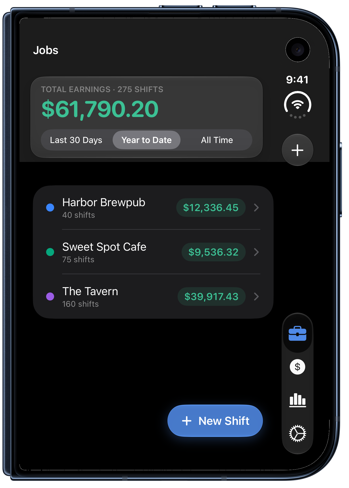
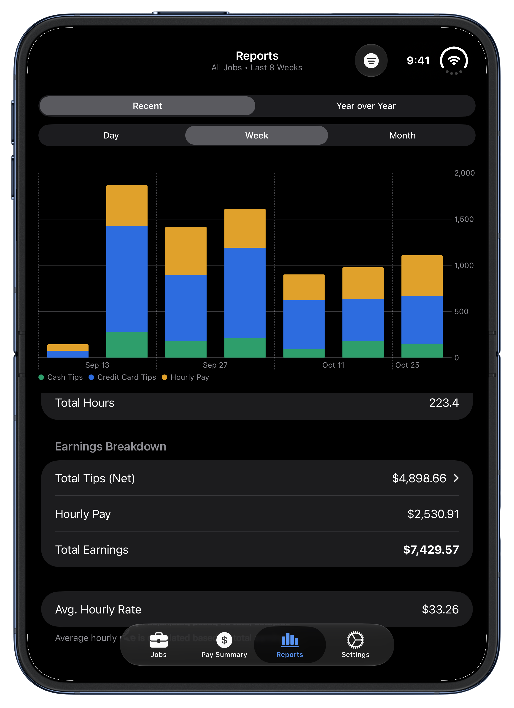
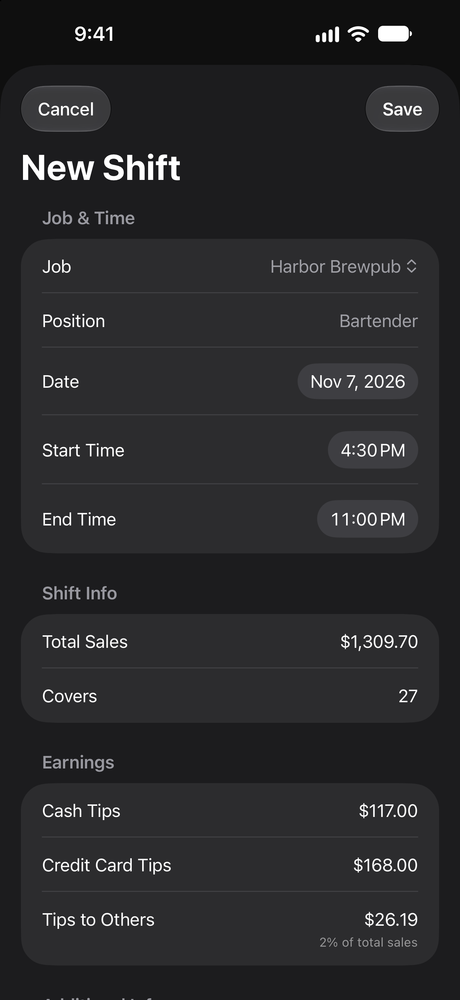
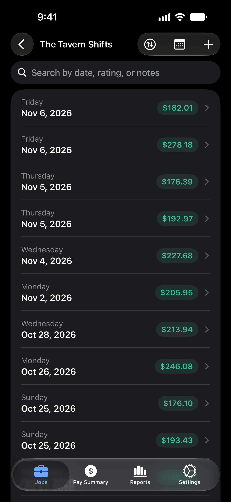
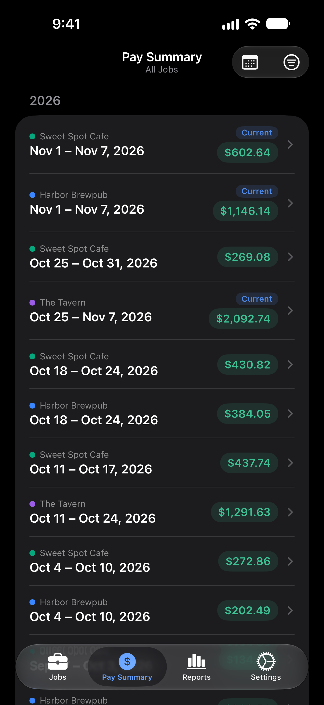

<section class="hero">
  <h1>Track your tips &amp; shift earnings, fast.</h1>
  

    Tip Sheet 2 is built for anyone who earns tips — servers, bartenders, baristas, hair stylists, rideshare drivers, delivery workers, and more. Log your shifts in seconds and see exactly what you're earning.
  

  

    <a class="cta-button" href="https://apps.apple.com/app/id6762172155">Download on the App Store</a>
    Free for up to 15 shifts &middot; One-time Pro unlock, no subscription
  

</section>

## Built for iPhone &amp; Ready for iPhone Duo

Glance at your earnings on the cover screen, or unfold for full interactive charts and shift breakdowns. Tip Sheet 2 adapts seamlessly across screen sizes.

  <figure>
    
    <figcaption>Cover screen: quick earnings overview by job</figcaption>
  </figure>
  <figure>
    
    <figcaption>Unfolded display: interactive charts &amp; rolling reports</figcaption>
  </figure>

## Everything You Need to Track Tip-Based Income

  

    <h3>Quick Entry</h3>
    
Log a shift in seconds with your default job and start time, or let Tip Sheet 2 suggest your nearest job based on location.

  

  

    <h3>Jobs, Positions &amp; Overtime</h3>
    
Manage multiple jobs with separate positions, effective-dated hourly rates, and daily or weekly overtime rules.

  

  

    <h3>Tip-Outs &amp; Coworker Tips</h3>
    
Configure tip-out rules by position and track both tips paid out and <strong>Tips from Others</strong> received from coworkers.

  

  

    <h3>Reports &amp; Year-over-Year</h3>
    
Explore rolling windows (including today's shifts) by day, week, or month, and compare performance <strong>Year over Year</strong>.

  

  

    <h3>Pay Period Summaries</h3>
    
See weekly, biweekly, or custom pay period breakdowns before payday — including hours, wages, and net tips.

  

  

    <h3>Tip Sheet v1 Import</h3>
    
Moving from the original Tip Sheet? Import your <code>.tsjson</code> backup or <code>.csv</code> export in Settings — imported shifts don't count toward the 15-shift free limit.

  

  

    <h3>iCloud Sync &amp; CSV Export</h3>
    
Your data and preferences sync automatically across your Apple devices via iCloud, with one-tap CSV export for taxes or budgeting.

  

  

    <h3>Privacy First</h3>
    
Your financial data stays on your device and in your personal iCloud account. No accounts to create, and no subscriptions.

  

## Inside the App

  <figure>
    
    <figcaption>Fast shift logging with customizable fields</figcaption>
  </figure>
  <figure>
    
    <figcaption>Searchable, filterable shift history</figcaption>
  </figure>
  <figure>
    
    <figcaption>Clear pay period totals before payday</figcaption>
  </figure>

## Need Help or Have Questions?

- Visit our [Support &amp; FAQ](./support) page for guides on importing Tip Sheet v1 data, iCloud sync, and Pro restore.
- Read our [Privacy Policy](./legal) to learn how your data is handled.
